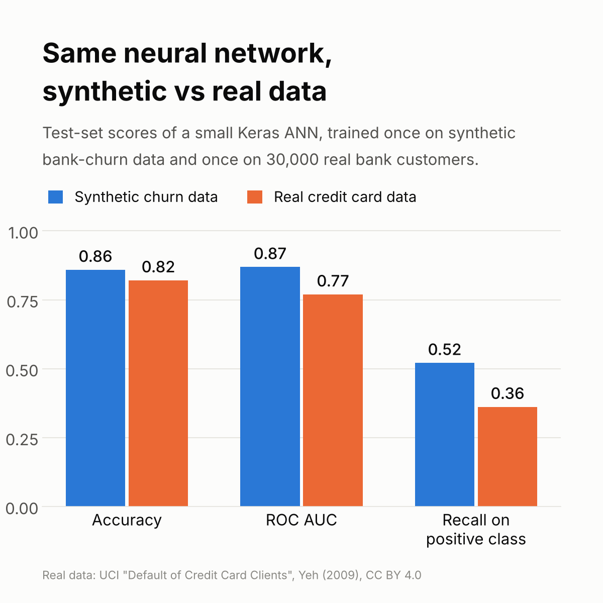
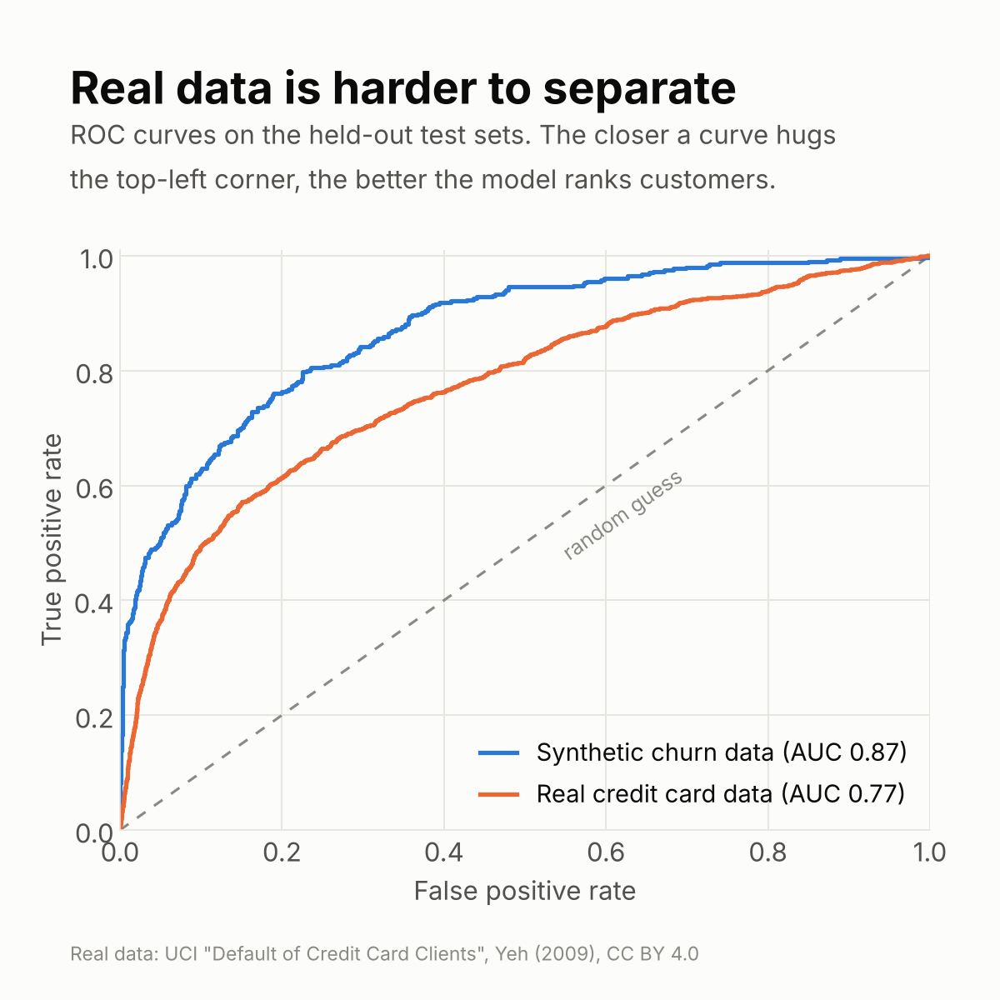
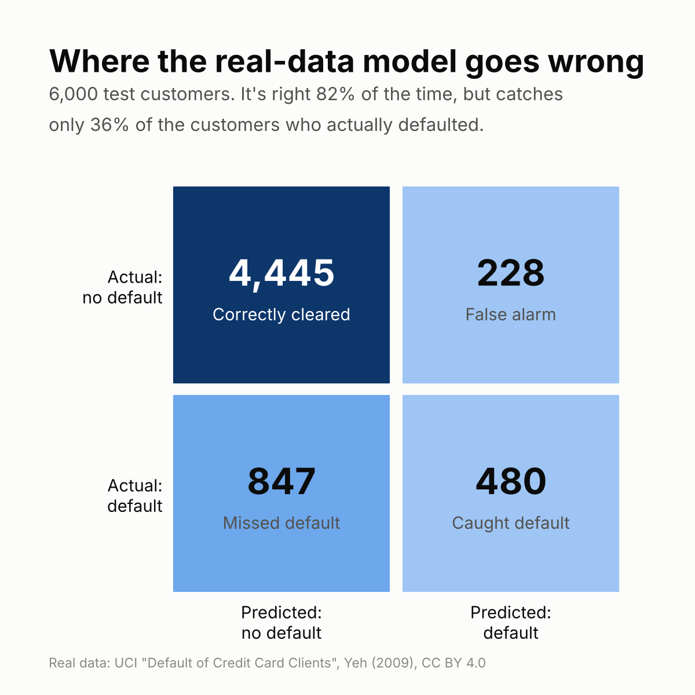

# Same neural network, synthetic vs real data

I built a small artificial neural network (Keras) to predict which bank customers will
leave, using the synthetic `Churn_Modelling.csv` dataset from a machine learning course.
It scored 86% accuracy. Then I wanted to know how the same kind of network does on
**real customers**, so I retrained it on the UCI
[Default of Credit Card Clients](https://doi.org/10.24432/C55S3H) dataset: 30,000 real
customers of a Taiwanese bank, predicting who defaults on next month's payment.



## Results

Held-out test sets (20% of each dataset, stratified for the real data):

| | Accuracy | Always guess "no" | ROC AUC | Recall on positive class |
|---|---|---|---|---|
| Synthetic churn data (10,000 customers) | 85.9% | 79.8% | 0.869 | 52% |
| Real credit card data (30,000 customers) | 82.1% | 77.9% | 0.770 | 36% |

What I took from it:

- **Accuracy flatters both models.** Around 78-80% of customers are negative in both
  datasets, so a model that always says "no" already gets most of that accuracy.
  ROC AUC and recall tell the real story.
- **Real data is noisier.** The same approach loses about 0.10 AUC on real customers.
  People don't default for reasons that fit neatly into 23 columns.
- **The model misses most defaulters.** At the default 0.5 threshold it catches only
  36% of them. Lowering the threshold or weighting the classes trades false alarms
  for more catches, which a bank would probably prefer.




## The model

Both scripts follow the same four steps: preprocess, build the ANN, train, evaluate.

**Original** ([`original/artificial_neural_network.py`](original/artificial_neural_network.py)):
label-encode Gender, one-hot encode Geography, standard-scale, then Dense 6 → 6 → 1
(ReLU, ReLU, sigmoid), Adam, binary cross-entropy, 100 epochs.

**Real data** ([`ann_credit_default.py`](ann_credit_default.py)), changes the new data needed:

- one-hot encode `EDUCATION` and `MARRIAGE` (like Geography) and binary-encode `SEX` (like Gender);
  undocumented codes (EDUCATION 0/5/6, MARRIAGE 0) are folded into "others"
- signed log transform on credit limit, bill and payment amounts, which are extremely skewed
- stratified train/test split, since only 22% of customers default
- Dense 16 → 8 → 1 with dropout 0.2, because there are 28 inputs instead of 12
- early stopping on validation AUC instead of a fixed 100 epochs
- reports ROC AUC, precision and recall as well as accuracy

## Run it

```bash
pip install -r requirements.txt
python ann_credit_default.py   # trains on data/, writes results/
python make_figures.py         # redraws images/ from results/
```

To rerun the original, put `Churn_Modelling.csv` in the repo root (it isn't included
here) and run `python original/artificial_neural_network.py`.

## Data and credits

- Real data: Yeh, I. (2009). *Default of Credit Card Clients* [Dataset]. UCI Machine Learning
  Repository. https://doi.org/10.24432/C55S3H. Licensed
  [CC BY 4.0](https://creativecommons.org/licenses/by/4.0/). See [`data/README.md`](data/README.md).
- The original churn network and `Churn_Modelling.csv` come from the
  *Machine Learning A-Z* course template.

This is a learning project. The model uses sex, age and marital status as inputs and
should not be used to make real lending decisions.
